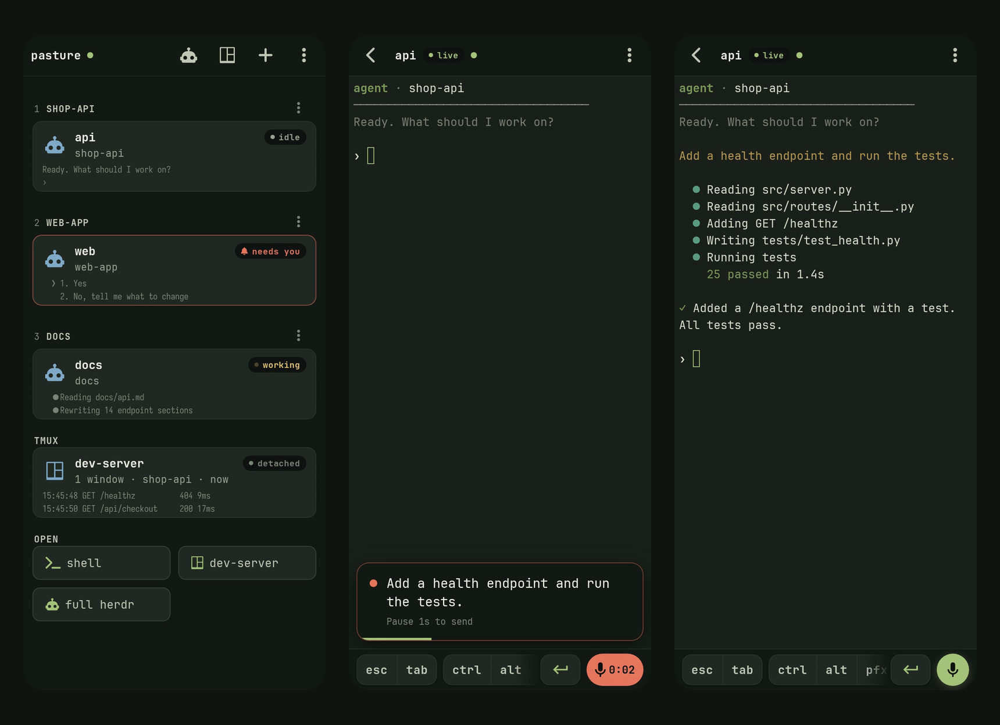

# pasture

**Your coding agents, on your phone.** A passkey-gated terminal and agent
dashboard for your own machine, served only on your Tailscale network and
installed on your phone's home screen.



- **See every agent at a glance**: which [herdr](https://herdr.dev) agent is
  working, done or needs you, with its last lines of output, plus your tmux
  sessions.
- **Jump in**: a full-screen terminal attached to the agent, tmux session or a
  shell, with a key bar made for thumbs (Esc, Tab, sticky Ctrl/Alt, arrows,
  Enter, paste).
- **Just say it**: tap the mic and talk. whisper.cpp transcribes on your own
  machine while you speak; pause, and it types the text and presses Enter.
- **Show it**: send a photo or screenshot from the phone into a session (the
  image key in the key bar, or paste); the agent gets the image.
- **Know when they finish**: push notifications to your lock screen when an
  agent needs you or is done, even with the app closed; tap one to open that
  agent. herdr agents report on their own; any other agent (Claude Code
  hooks, scripts) with `pasture notify`. No Apple Developer account and no
  third-party notification app.
- **Yours**: it runs as your user on your machine (Linux, macOS or Windows).
  Passkey login (Face ID), one-time QR enrollment, reachable only on your
  tailnet. No accounts, no telemetry, no CDN.

## Get started

You need [Tailscale](https://tailscale.com/download) on the machine and on the
phone, with MagicDNS on. Then:

```sh
# 1. Install: a binary from Releases (Linux, macOS, Windows), or `nix run github:fluxoz/pasture`
curl -fL -o ~/.local/bin/pasture https://github.com/fluxoz/pasture/releases/latest/download/pasture-linux-x86_64
chmod +x ~/.local/bin/pasture

# 2. HTTPS: turn on "HTTPS certificates" in the Tailscale admin console, or use your own CA:
pasture tls init && pasture tls phone     # then trust the CA on the phone (scan the QR code)

# 3. Run it (always on), and enroll the phone: scan the QR code, Create passkey, Add to Home Screen
pasture service install
pasture enroll

# 4. Claude Code sessions notify the phone; check that everything is in place
pasture hooks claude --install
pasture doctor
```

The full walk-through, including the phone side, is
**[docs/setup.md](docs/setup.md)**. On NixOS, add the module instead
([docs/nixos.md](docs/nixos.md)):

```nix
services.pasture = {
  enable = true;
  user = "alice";
  hostName = "myhost.your-tailnet.ts.net";
};
```

## Let your agent set it up

Point your coding agent at this repository:

> Set up pasture on this machine so I can use it from my phone. Follow
> https://github.com/fluxoz/pasture/blob/main/AGENTS.md

[AGENTS.md](AGENTS.md) tells it what to check (`pasture doctor --json`), what
to ask you (HTTPS mode, background service, hooks), what only you can do (scan,
Face ID, Add to Home Screen) and what never to do (expose it beyond your
tailnet, run it as root).

## Documentation

- [Getting started](docs/setup.md): Tailscale, install, HTTPS, enrolling,
  running it as a service, notifications, dictation, updating, uninstalling.
- [HTTPS and certificates](docs/tls.md): Tailscale's certificate or your own
  CA, installing the CA on iPhone and Android, renewing, NixOS with nginx and
  sops-nix.
- [NixOS and home-manager](docs/nixos.md): the modules, herdr, GPU dictation,
  Claude Code hooks, passkeys from your secrets manager.
- [Troubleshooting](docs/troubleshooting.md)
- [Security model](SECURITY.md)

## Works with

- **[herdr](https://herdr.dev)** for the agent dashboard: any agent herdr
  tracks (Claude Code, Codex, ...). Its status changes drive the badges and
  push notifications. Without herdr you get tmux sessions and shells.
- **tmux**: list, attach, create in a project directory, rename, kill.
- **Plain shells**: your login shell.
- **Any agent's hooks**: `pasture notify --hook claude stop` (and
  `notification`) from Claude Code hooks; `services.pasture.notify.claudeCode`
  sets them up on NixOS ([setup guide](docs/setup.md#5-notifications)).
- **ntfy** (optional): an inbox fed by a topic on the same machine, also
  forwarded as push notifications.

## Security and privacy

pasture gives whoever unlocks it **a shell as your user**. It is built for one
owner on a private network. Read [SECURITY.md](SECURITY.md).

- **Tailnet only.** `tailscale serve` (never `funnel`) or nginx bound to your
  tailnet address. If you share the tailnet, limit the port to your own
  devices with Tailscale ACLs.
- **Passkeys**: exact origin and RP ID checks, user verification required,
  single-use 120 s challenges. Enrollment codes are one-time and travel in the
  URL fragment, which browsers never send to a server.
- **Sessions**: `__Host-` cookie (Secure, HttpOnly, SameSite=Strict), 30 min
  idle and 8 h absolute, in memory. Every POST and WebSocket checks `Origin`;
  strict CSP; terminals run a fixed command per target kind.
- **What leaves the machine**: with Tailscale's certificate, the machine's
  `ts.net` name appears in public Certificate Transparency logs. Your own CA
  (`pasture tls init`, or the nginx frontend on NixOS) avoids that; the CA is
  name-constrained to that one name, so trusting it on the phone risks
  nothing else. Push notifications go through the
  phone's push service (Apple's for an iPhone), encrypted end to end, so it
  sees only size and timing. Nothing else: dictation audio stays on the
  machine, and fonts and xterm.js are bundled.

## Requirements

- Linux (x86_64, arm64), macOS (Apple Silicon, Intel) or Windows (x86_64);
  NixOS and home-manager modules for Nix users. On Windows the terminals are
  PowerShell and there is no tmux or herdr dashboard.
- Tailscale with MagicDNS, plus HTTPS certificates or your own CA.
- A phone browser with passkeys. Push needs iOS 16.4+ with the app installed.
- Fast dictation wants a GPU build of whisper.cpp (Vulkan or CUDA): the text
  lands about 50 ms after you pause. On a fast CPU it is about half a second.

## Configuration

### NixOS options

All under `services.pasture`; only `enable`, `user` and `hostName` are required.

| Option | Default | Notes |
|---|---|---|
| `user` | required | Account whose shells are served; the gateway is its user unit. |
| `hostName` | required | The name the phone uses: WebAuthn RP ID and origin. Passkeys are bound to it. |
| `frontend` | `"tailscale"` | `"tailscale"` (`tailscale serve`, needs `services.tailscale.enable`) or `"nginx"`. |
| `listenAddresses` | `[ ]` | nginx: listen IPs; wildcards need `allowWildcardListen`. |
| `listenPort` / `backendPort` | `443` / `8795` | The gateway binds 127.0.0.1 only. |
| `allowedCIDRs` / `firewall.interfaces` | `[ ]` | nginx: allowed client networks; interfaces that get `listenPort`. |
| `nonlocalBind` / `nginx.after` | `false` / `[ ]` | nginx: bind an address that appears after boot (start after `tailscaled.service`). |
| `tls.certFile` / `tls.keyFile` / `tls.acmeHost` | `null` | nginx: your certificate. |
| `secrets.sessionKeyFile` / `enrollTokenFile` / `credentialsFile` | `null` | Optional; without them the gateway keeps its own in its state dir. |
| `enrollment.enable` | `credentialsFile == null` | With a credentials secret, turn it off to allow only those passkeys. |
| `push.enable` / `push.subject` | `true` / `null` | Web Push; nothing is sent until a device turns it on. |
| `notify.claudeCode` | `false` | Claude Code hooks (managed settings) that report to pasture; `pasture-notify` is installed either way. |
| `session.idleMinutes` / `absoluteMinutes` | `30` / `480` | |
| `appName` / `shortName` | `"pasture"` | Home-screen label. |
| `shell.enable` / `shell.command` | `true` / `null` | `null` = login shell. |
| `tmux.enable` / `tmux.defaultSession` | `true` / `null` | |
| `herdr.package` / `sessions` / `agentKinds` / `prefixKey` | `null` / `[ "default" ]` / `[ ]` / `"ctrl+b"` | `null` disables herdr. |
| `projectRoots` | `[ "~" ]` | Where new sessions and agents may start. |
| `alerts.ntfy.url` / `topic` | `null` / `"agents"` | |
| `dictation.enable` / `package` / `model` | `false` / `pkgs.whisper-cpp` / `null` | Use `whisper-cpp-vulkan` (or a CUDA build) for speed. |
| `dictation.idleMinutes` / `prompt` / `extraArgs` | `0` / `null` / `[ ]` | 0 keeps the model loaded from boot; whisper's initial prompt; extra `whisper-server` flags. |
| `dictation.language` / `threads` / `maxSeconds` | `"en"` / `4` / `60` | |
| `theme.palette` / `theme.fonts` | "pasture dark" / JetBrains Mono | Any palette ([schema](nix/themes/schema.md)) and Nerd Font. |
| `extraEnvironment` | `{ }` | Extra gateway (and shell) environment. |

### The `pasture` command

| Command | |
|---|---|
| `pasture` / `pasture serve` | Run it. `--host` (default: the MagicDNS name), `--port`, `--https-port`, `--name`, `--state`, `--no-tailscale-serve`, `--tailscale-cert`. |
| `pasture enroll [--new]` | QR code to enroll a device (one-time). |
| `pasture tls init [--renew]` / `tls phone` | Your own CA and certificate; serve the CA for the phone. |
| `pasture service install` / `uninstall` | Background service (systemd, launchd, Windows Startup). `--dry-run`; serve options after `--`. |
| `pasture hooks claude\|grok [--install]` | Agent hooks that report to pasture. |
| `pasture notify [--kind done\|blocked\|info] [--agent A] [--project P] TEXT` | Send an alert (`--hook AGENT EVENT` reads a hook's JSON on stdin). |
| `pasture doctor [--json]` | Check everything; print fixes. |

`PASTURE_*` environment variables ([config.py](gateway/pasture/config.py)) set
the rest, e.g. `PASTURE_DICTATE_SERVER` and `PASTURE_DICTATE_MODEL`.

## Troubleshooting

`pasture doctor` first; then [docs/troubleshooting.md](docs/troubleshooting.md).

## Development

```sh
nix develop
cd gateway && python -m unittest discover -s tests -t . -v
nix build .#gateway .#web .#pasture   # the gateway's tests run here too
```

Layout: `gateway/` (Python: auth, sessions, providers, PTY bridge, dictation,
push, the `pasture` command), `web/` (vanilla ES modules, one stylesheet, the
bundle builder), `nix/` (packages, theme, NixOS and home-manager modules),
`examples/`.

## License and credits

MIT. Bundled at build time: xterm.js and addons (MIT), JetBrains Mono and the
Nerd Fonts symbols (OFL-1.1 / MIT).
